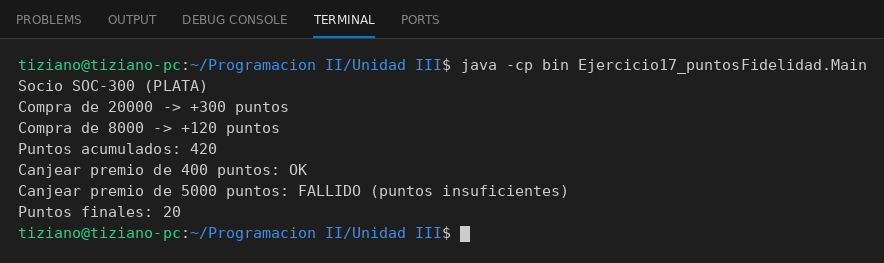

# CuentaFidelidad

Programación II - Unidad 3 - Ejercicio 17

## Consigna
Modelar la clase aplicando encapsulamiento: atributos privados y métodos públicos que validan antes de modificar el estado. Una cuenta de puntos de fidelidad que se acumulan y canjean por reglas internas.

## Lógica
- `acumularPuntos(monto)` calcula 1 punto cada 100 pesos por un multiplicador según el nivel (BRONCE, PLATA, ORO).
- `canjearPremio(puntos)` verifica que haya saldo de puntos suficiente.
- El saldo de puntos es privado.
- `Main` simula compras y canjes exitosos y fallidos.

## Ejecución

